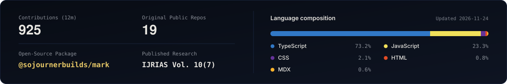

  <a href="https://inioluwaosibajo.vercel.app/">
    <picture>
      <source media="(prefers-color-scheme: dark)" srcset="./assets/hero-dark.svg" />
      <source media="(prefers-color-scheme: light)" srcset="./assets/hero-light.svg" />
      
    </picture>
  </a>

  
  
  
  
  
  

---

## Overview

I'm a software engineer working on B2B web apps, logistics dispatch tools, and offline-first retail software—mostly with TypeScript, React, and Next.js.

Through **[Sojourner Builds](https://www.npmjs.com/package/@sojournerbuilds/mark)**, I publish small open-source packages and side projects. I also write technical notes on web architecture and co-authored a peer-reviewed paper in *IJRIAS* on zero-shot NLP.

---

## Selected Work

<table>
  <tr>
    <td width="50%" valign="top">
      <strong>B2B Logistics &amp; Dispatch Platforms</strong> 
      Web apps built for nationwide delivery operations across 16+ cities in Nigeria: a <a href="https://picckr.com/">public tracking site</a>, a <a href="https://business.picckr.com/">B2B merchant portal</a> with bulk CSV ordering and WebSocket dispatch, and a <a href="https://partners.picckr.com/">fleet operations workspace</a>.  
      <code>Next.js</code> <code>React</code> <code>TypeScript</code> <code>WebSockets</code> <code>Tailwind CSS</code>
    </td>
    <td width="50%" valign="top">
      <strong><a href="https://www.npmjs.com/package/@sojournerbuilds/mark">@sojournerbuilds/mark</a></strong> 
      Zero-dependency SVG waymark component and Next.js App Router loading veil (<code>&lt; 4kB</code> CSS, respects <code>prefers-reduced-motion</code>).  
      <code>TypeScript</code> <code>React</code> <code>SVG</code> <code>npm</code>
    </td>
  </tr>
  <tr>
    <td width="50%" valign="top">
      <strong><a href="https://github.com/chubbyini/stockfindr">Stockfindr</a></strong> 
      Offline-first Next.js PWA for retail shops with ZXing barcode scanning, an IndexedDB outbox (10s undo), Firestore sync, and nightly Telegram summaries via Trigger.dev.  
      <code>Next.js</code> <code>Firebase</code> <code>Dexie</code> <code>Zustand</code> <code>Trigger.dev</code>
    </td>
    <td width="50%" valign="top">
      <strong><a href="https://github.com/chubbyini/crimson-uplink">Crimson Uplink</a></strong> (<a href="https://crimsonuplink.vercel.app/">Live</a>) 
      BYOK developer writing tool that pulls daily trends from HN, RSS, GitHub, and Dev.to, ranks angles with Gemini Flash, drafts via Groq, and sends Telegram digests to approve and publish.  
      <code>Next.js</code> <code>TypeScript</code> <code>Firestore</code> <code>Gemini</code> <code>Groq</code>
    </td>
  </tr>
  <tr>
    <td width="50%" valign="top">
      <strong><a href="https://github.com/chubbyini/ikomrealtimechatapps">Ikom Real-Time Chat</a></strong> (<a href="https://ikomrealtimechatapps.onrender.com/login">Live</a>) 
      Real-time chat app built with Socket.io, Express, and React—supports chat rooms, online presence, persistent history, and automatic reconnects.  
      <code>Node.js</code> <code>Express</code> <code>Socket.io</code> <code>React</code>
    </td>
    <td width="50%" valign="top">
      <strong><a href="https://github.com/chubbyini/porfolioinitial">Portfolio &amp; Studio</a></strong> (<a href="https://inioluwaosibajo.vercel.app/">Live</a>) 
      Personal site with project case studies and an MDX blog, built in Next.js 15, strict TypeScript, and Framer Motion.  
      <code>Next.js 15</code> <code>TypeScript</code> <code>Framer Motion</code> <code>MDX</code>
    </td>
  </tr>
</table>

---

## Activity

  <a href="https://github.com/chubbyini">
    <picture>
      <source media="(prefers-color-scheme: dark)" srcset="./assets/stats-dark.svg" />
      <source media="(prefers-color-scheme: light)" srcset="./assets/stats-light.svg" />
      
    </picture>
  </a>

---

## Research & Writing

**Peer-Reviewed Paper (July 2025)**

> **[Hybrid Zero-Shot NLP Pipeline for Text Summarization and Question Generation](https://ideas.repec.org/a/bjf/journl/v10y2025i7p342-354.html)**
> Inioluwa Daniel Osibajo, Oluwaseyi Ezekiel Olorunshola, Fatimah Adamu-Fika, Tsentob Joy Samson — *International Journal of Research and Innovation in Applied Science (IJRIAS)*, Vol. 10, Issue 7, pp. 342–354 (AFIT, Kaduna).

**Selected Essays**

- [Optimizing Performance Without Falling for the RSC Hype](https://dev.to/osibajo_inioluwa_74301be0/optimizing-performance-without-falling-for-the-rsc-hype-46oo) — *Dev.to*
- [Zero-Byte Design: How I Use Math to Generate Unique Storefronts Without a DB](https://medium.com/@inioluwaosibajo/zero-byte-design-how-i-use-math-to-generate-unique-storefronts-without-a-db-47685cedce18) — *Medium*
- [I Refused to Pick a Map Provider. Here's the Architecture That Lets Me Use Both.](https://medium.com/@inioluwaosibajo/i-refused-to-pick-a-map-provider-heres-the-architecture-that-lets-me-use-both-0b966c2aa2cc) — *Medium*
- [The WhatsApp Economy: Re-engineering E-commerce for Nigeria's Informal Markets](https://medium.com/@inioluwaosibajo/the-whatsapp-economy-re-engineering-e-commerce-for-nigerias-informal-markets-70d2feb9c379) — *Medium*

---

## Core Stack

| Layer | Technologies |
|---|---|
| **Frontend & Design** | Next.js (App Router), React, TypeScript, Tailwind CSS, Framer Motion, Zustand, React Hook Form, Zod, Accessibility (a11y) |
| **Backend & Real-Time** | Node.js, Express, REST APIs, Socket.io / WebSockets, Firebase & Firestore, MongoDB, Dexie (IndexedDB) |
| **AI & NLP Research** | Python, Hugging Face Transformers, Zero-Shot Pipelines, PyTorch, ROUGE / BLEU Evaluation, Gemini & Groq APIs |
| **Workflow & Infrastructure** | Git & GitHub, GitHub Actions, npm Publishing, Vercel, Trigger.dev, Postman, Figma to Code |

---

  <picture>
    <source media="(prefers-color-scheme: dark)" srcset="./assets/footer-dark.svg" />
    <source media="(prefers-color-scheme: light)" srcset="./assets/footer-light.svg" />
    
  </picture>

